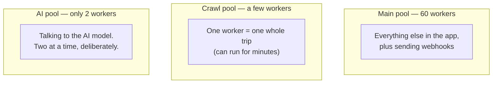

# The Crawler, Explained Simply

**In one sentence:** you give it a website address, and it visits that site on a
schedule, notices what changed, uses AI to pull the useful facts out of each
page, and writes them as rows in a table you own.

This file is written to be understood fast — by a person who has never seen this
codebase, and by an AI reading the repo. Plain words come first. The real
function and file names sit in `code font` next to them, so nothing here is a
simplification you have to unlearn later.

---

## 1. The 30-second version

Think of a **robot with a notebook**.

1. You tell the robot: *"go look at this shop's website every morning."*
2. Each morning the robot walks the site, one page at a time, politely.
3. For each page it asks: **"is this the same as yesterday?"** If yes, it does
   nothing — that page is free.
4. If a page changed, the robot reads it and writes down the useful bits
   (product name, price, whatever you asked for) as **rows in your table**.
5. It crosses out rows that disappeared and adds rows that are new.
6. When the trip ends, it tells you what changed — on the dashboard, and
   optionally by messaging your server.

Everything else in this document is detail about how it stays honest, polite,
and cheap while doing that.

---

## 2. The whole thing as one picture

```mermaid
flowchart LR
    A["You: a website address<br/>+ how often to check"] --> B["Job<br/>(the standing instruction)"]
    B --> C{"Time to go?"}
    C -->|"schedule fires,<br/>or you click Run now"| D["Run<br/>(one trip)"]
    D --> E["Visit pages politely,<br/>one at a time"]
    E --> F{"Is this page the same<br/>as last time?"}
    F -->|"yes"| G["Skip it.<br/>Costs nothing."]
    F -->|"no"| H["Save a copy of the page"]
    H --> I{"Do we already know<br/>where the data sits?"}
    I -->|"yes — a recipe"| J["Grab it with CSS.<br/>No AI. Free."]
    I -->|"no"| K["Ask the AI<br/>to read the page"]
    J --> L["Check every value is<br/>really visible on the page"]
    K --> L
    L --> M["Swap old rows to new rows<br/>(carefully, never half-done)"]
    M --> N["Record what changed"]
    N --> O["Trip ends"]
    O --> P["Tell you: dashboard,<br/>webhook, alerts"]
```



---

## 3. The story of one page

The same story again, but following a single page all the way through, with the
real code named at every step.

| # | In plain words | In the code |
|---|---|---|
| 1 | You click **Run now** | `StartCrawlRunCommand` |
| 2 | The job goes in a queue so a worker picks it up | Asynq `crawler` queue |
| 3 | A worker grabs a free robot and starts the trip | `ExecuteRun` (`executor.go`) |
| 4 | The robot loads what it remembers about this site | `prepareRunSession` |
| 5 | It checks the site's rules before knocking | `robots.txt`, RFC 9309 |
| 6 | It waits its turn so it never hammers one site | host gate (`crawl:hostslot:*`) |
| 7 | It fetches the page | `ManagedCrawl` (`core/tools/`) |
| 8 | It fingerprints the page to see if it changed | dual content hash |
| 9 | Unchanged → stop here, costs nothing | the incremental wall |
| 10 | Changed → save a copy of the page as a file | `SaveManagedFile` |
| 11 | Remember this page's fingerprint for next time | `UpsertURLState` |
| 12 | Hand the page to the reading queue | `ExtractCrawlPageCommand` |
| 13 | Exactly one worker claims this page | ledger claim (5-minute steal) |
| 14 | Read it — cheap way if possible, AI if not | `applyContract` / LLM |
| 15 | Throw away anything the page doesn't actually show | the "wall" checks |
| 16 | Replace this page's old rows with the new rows | run-fenced row swap |
| 17 | Write down what was added, changed, removed | change events |
| 18 | When every page is done, close the trip | `ReconcileCrawlRun` |
| 19 | **Only now:** send the webhook, update the averages | `ClaimRunSignals` |

---

## 4. The words we use

Read this table and most of the codebase stops being mysterious.

| Simple word | Real name | What it actually is |
|---|---|---|
| Standing instruction | **Job** (`crawl_jobs`) | The site, how deep to go, how often, which table to fill |
| One trip | **Run** (`crawl_runs`) | A single visit to the site, start to finish |
| Robot | **Bot** | A worker slot; there are only a few, so trips queue up |
| Page memory | **URL state** (`crawl_url_state`) | What we remember about one page: fingerprint, file, streak |
| Fingerprint | **Content hash** | A short code for the page's bytes. Same code = same page |
| Notebook line | **Row** (a Forms response) | One extracted record — one product, one article |
| Recipe | **Extraction contract** | Learned CSS selectors: "the price lives here." Free to re-run |
| Asking the AI | **LLM extraction** | Slow and costs money, so we avoid it when a recipe works |
| Crossing-out | **Change event** (`crawl_changes`) | added / changed / removed, per row |
| Messaging you | **Webhook** | A signed POST to your server when a trip finds changes |
| Trip diary | **Run events** (`crawl_run_events`) | The log you can read: every skip, every failure |
| Waiting your turn | **Host gate** | A shared timer so all robots stay polite to one site |
| Giving up on a sick site | **Circuit breaker** | Stop hammering a site that keeps failing |

---

## 5. The rules that must never be broken

Each of these exists because breaking it caused real damage.

1. **Never let a bad crawl delete good data.**
   If a site shows a "prove you're human" wall, that page loads fine but
   contains nothing. Believing it would mean writing *"the shop is empty, delete
   everything."* So a suspiciously tiny page is marked **failed**, and
   yesterday's rows are left untouched. (`soft_error.go`)

2. **Replace rows carefully, never half-way.**
   New rows go in, *then* old ones come out, and the whole swap is stamped with
   which trip did it. A slow, stale trip can never delete a newer trip's work.

3. **One trip per job at a time.**
   Enforced by the database itself, not by hope. A second start is refused.

4. **Only write down what the page actually shows.**
   Every text value the AI returns must be findable on the page. If it isn't,
   the AI invented it, and it is dropped.

5. **Be polite, always.**
   One request at a time per site, honouring the site's requested delay.
   Politeness is shared across every robot on every server — and it is never
   shortened to help a trip finish faster.

6. **Finish before you announce.**
   The webhook, the alerts and the averages fire only once *every* page of the
   trip has finished being read — not when the trip merely *looks* done.

7. **A cut-short trip is not a measurement.**
   If a trip ran out of time, its numbers move no baseline and raise no "rows
   dropped!" alarm. It was interrupted, not informative.

8. **Never trust the instructions attached to a task.**
   Background tasks re-read the job from the database instead of believing what
   was handed to them, so a forged task cannot redirect the crawler.

9. **Every database read is scoped to its owner.**
   One tenant can never see another's jobs, pages or rows. The few deliberately
   fleet-wide reads are listed, justified, and admin-only.

10. **Errors never leak internals.**
    You get "something went wrong, see server logs" — never a database address
    or a stack trace.

---

## 6. The three teams

There are three separate pools of workers, on purpose.



Why separate? A trip can take minutes, and an AI call is slow and expensive. If
those shared the main pool, ordinary web requests would starve behind them.
**The AI pool having only 2 workers is the actual spending limit** — three AI
calls can never be in flight at once.

---

## 7. Where things are kept

| What | Where | Note |
|---|---|---|
| Jobs, trips, page memory, changes | MongoDB `crawlerdb` (11 collections) | The crawler's own brain |
| Saved copies of pages | Your file area, "Crawl Data" folder | Browsable like any file |
| Searchable page text | Qdrant vectors | So chat can answer from crawled pages |
| **The extracted rows** | Your Forms table | **This is the product.** Everything else supports it |
| Politeness timers, failure counts | Redis | Shared across all servers |

---

## 8. Two clever tricks worth knowing

**The cheap path (recipes).**
The first time we read a site, the AI does the work. While doing it, the system
tries to learn *where* on the page each value lived, expressed as CSS selectors.
It then checks that recipe by replaying it and comparing against the AI's own
answer. If they match, later trips use the recipe and skip the AI entirely —
same rows, no cost.

**Learning what never changes (shadow mode).**
Some pages haven't changed in months, so re-checking them every trip is waste.
The system now counts, for every page, how many trips in a row it stayed the
same, and records **what it *would* have skipped** and how often that would have
been wrong.

> **Important: it is not skipping anything yet.** This is measurement only. The
> decision to actually skip pages comes later, once the recorded numbers show it
> would be safe. Nothing in the current code skips a scheduled page because of
> this.

---

## 9. What is deliberately *not* built

Being explicit here prevents wrong assumptions:

- **Live skipping of pages** — measured only, never acted on (see §8).
- **A real browser for JavaScript-heavy sites** — there is a browser-free trick
  that reads data hidden inside a page's scripts, but no headless browser.
- **Re-sending a webhook after the crawler is switched back on** — if delivery
  is settled while the crawler is off, it is not re-sent later. The trip's log
  records that it wasn't delivered, so the record never lies.

---

## 10. Where the code lives

```
backend/
  core/tools/managed_crawl.go        the robot: fetching, politeness, robots.txt
  core/tools/host_gate.go            waiting your turn, shared across servers
  micro-services/shell-api/
    business/services/crawler/
      executor.go                    one trip, start to finish
      extraction.go                  reading pages, swapping rows, closing the trip
      recipe_*.go                    learning / checking / using the cheap path
      structuring_*.go               proposing what columns the table should have
      revisit*.go                    the "what never changes" measurement
      soft_error.go                  the "don't delete good data" guard
      webhook.go                     telling your server
      scheduler.go                   firing schedules, cleaning up stuck trips
    business/repository/crawler/     every database read and write
    handlers/commands/crawler-command/   the 30 commands the outside world calls
frontend/src/app/features/crawler/   the dashboard you look at
```

---

## 11. Facts table

Stable numbers, for quick reference and for machines.

| Fact | Value |
|---|---|
| Crawler commands | 30 |
| Worker pools | 3 (main 60 / crawl / AI 2) |
| Database collections (`crawlerdb`) | 11 |
| Pages tracked per job, maximum | 2000 |
| Unchanged trips before a page counts as "stable" | 3 |
| Days unreachable before a page is archived | 45 |
| Site says "too many requests" | honoured, never shortened |
| Site returns 5xx on `robots.txt` | treated as "do not crawl" |
| Site returns 4xx on `robots.txt` | treated as "crawling allowed" |

---

## 12. If you only remember five things

1. **Job** = the standing instruction. **Run** = one trip. **Row** = the output.
2. Unchanged pages cost nothing; that is what makes repeat trips cheap.
3. The AI is the expensive part, so the system works hard to avoid it.
4. Every guard in here exists to protect the rows you already have.
5. The "learning what never changes" feature is currently **only watching**.
